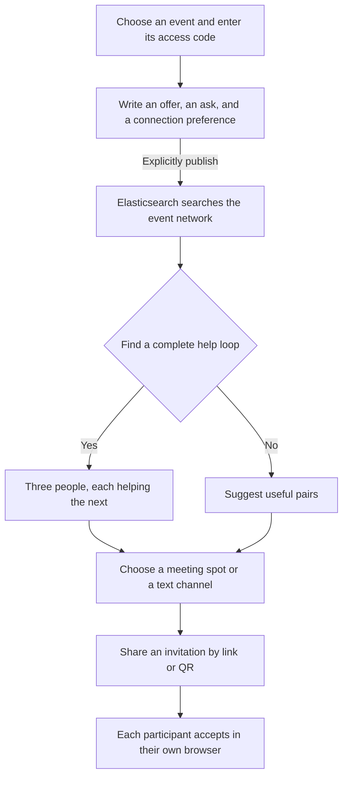

# Cloud Native Hackathon 2026: Detour

[Open Detour](https://salty.cnh.radarhq.io)

Conferences put the right people in the same building. Finding them still takes confidence, connections, and luck. Detour turns **“I can help with…”** and **“I’m looking for help with…”** into an introduction between the talks.

You help Sam deploy Kubernetes. Sam helps Lee review accessibility. Lee helps you optimize an on-device model. **Everyone gives something. Everyone gets help.**

## From introduction to connection



Every arrow needs a shared keyword between someone's offer and another's ask. The matcher normalizes terms such as `k8s` and `Kubernetes`, explains each connection, and respects published availability and connection preferences.

Cloud Native Hackathon and KubeCon NA 2026 have separate networks. **Add your event** prepares a public GitHub contribution for the requester to review and propose through a pull request.

## Built for people who haven't found their people yet

- **Everyone can contribute.** Newcomers, students, and solo attendees can offer feedback or a fresh perspective.
- **Choose how to connect.** In-person invitations suggest a meeting spot; Text first requires an external channel or messaging plan.
- **Consent at each step.** Drafts stay local until publication. Introductions can be withdrawn. Invitations expire after 24 hours; each member accepts independently.
- **Accessible interactions.** Labeled controls, keyboard navigation, dialog focus restoration, visible focus, reduced-motion support, and layouts checked down to 320 CSS pixels. Copyable links offer an alternative to QR or NFC.

## Participation in tracks

| Service           | What it does in Detour                                                                                                                                                                                        | What we demonstrated                                                                                                                                          |
| ----------------- | ------------------------------------------------------------------------------------------------------------------------------------------------------------------------------------------------------------- | ------------------------------------------------------------------------------------------------------------------------------------------------------------- |
| **Elasticsearch** | Stores profiles and invitations; powers lexical `multi_match` search with event, topic, and availability filters. Strict mappings, public-field projections, and optimistic concurrency protect shared state. | Live publication, search, authorization, acceptance, and withdrawal checks.                                                                                   |
| **Dash0**         | Collects explicit OpenTelemetry spans for application operations and Elasticsearch calls, including latency, status, and Kubernetes context.                                                                  | Agent0 identified repeated index checks. A 60-second cache with failure recovery reduced warm readiness/network calls from **3 Elasticsearch requests to 1**. |
| **Radar**         | UI and MCP support runtime configuration and rollout checks on the hackathon-provided `salty` cluster, namespace `team-salty`.                                                                                | An AI investigation verified a healthy release, expected image, ready replica, and zero restarts at the observed point.                                       |
| **Gitar**         | Reviews feature PRs using project-specific [review instructions](.gitar/review/detour.md) and [repository rules](.gitar/rules).                                                                               | Findings led to batched attendee lookups, safe draft persistence, and server-enforced meeting plans.                                                          |

## Try the whole circle

Use three separate browser profiles or cookie jars, select the same event, and publish these demo introductions with **Text first** and availability enabled:

| Attendee   | I can help with                 | I'm looking for help with       |
| ---------- | ------------------------------- | ------------------------------- |
| Alex Demo  | On-device AI model optimization | Kubernetes deployment           |
| Blair Demo | Kubernetes deployment           | Accessibility review            |
| Casey Demo | Accessibility review            | On-device AI model optimization |

Refresh Alex's discovery view: **Alex → Casey → Blair → Alex**. Create an invitation with an agreed text-channel plan, accept from the other two sessions, and refresh to see responses persist. Ordinary tabs share an identity. Connected access requires an organizer-provided event code.

## Run locally

Use **Node 24** and npm. In a fresh checkout:

```sh
npm ci
cp .env.example .env.local
npm run dev
```

Open [localhost:3000](http://localhost:3000). Empty Elasticsearch settings enable the labeled fictional preview. Configure Elasticsearch for shared profiles, OTLP for Dash0, and event codes for production. Keep credentials in `.env.local`. [Full setup](docs/integrations.md).

```sh
npm test
npm run build
npm run typecheck
```

## Current scope and AI disclosure

Matching uses deterministic keywords across up to 100 candidates; no vectors, hybrid search, or RAG. Text conversations use external channels. Event codes control access without verifying attendance. Invitation URLs support NFC cards; physical phone/NFC use and a full accessibility audit remain unverified. Performance figures come from small laptop-to-service experiments. Provider investigation links require account access; [release evidence](docs/integrations.md) records deployment verification.

**AI use:** Built with Codex assistance for implementation, tests, and documentation. Gitar reviewed PRs; Dash0 Agent0 and Radar AI supported investigations. Attendee matching uses deterministic code.
